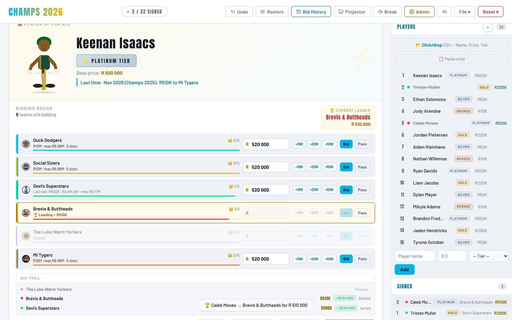
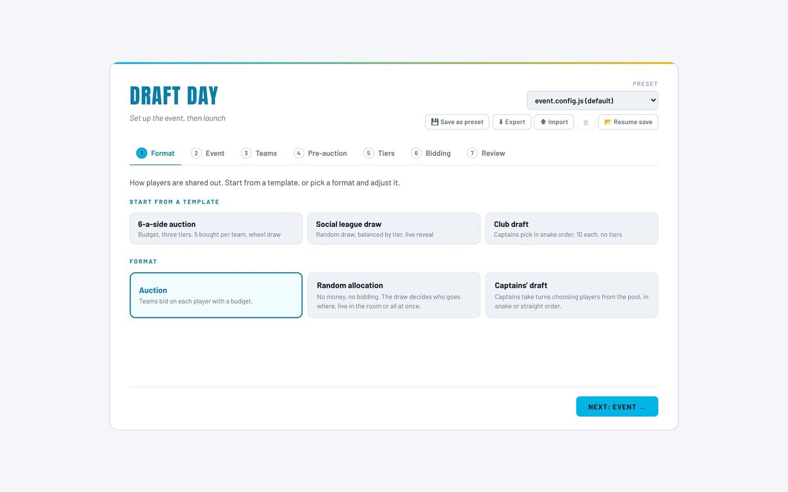
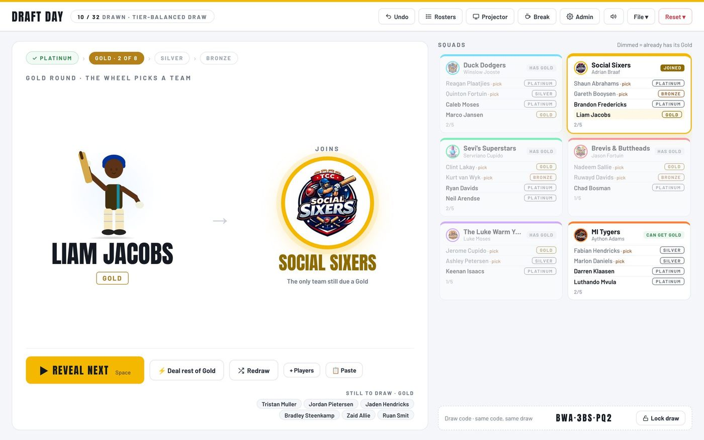
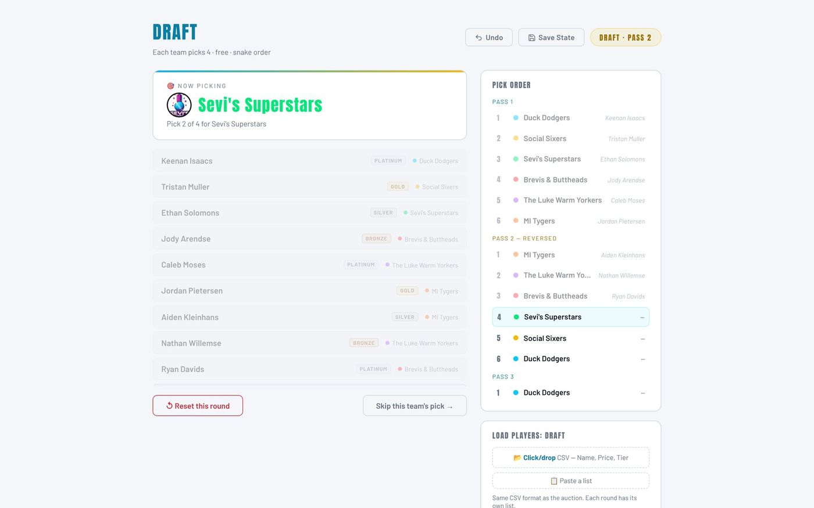
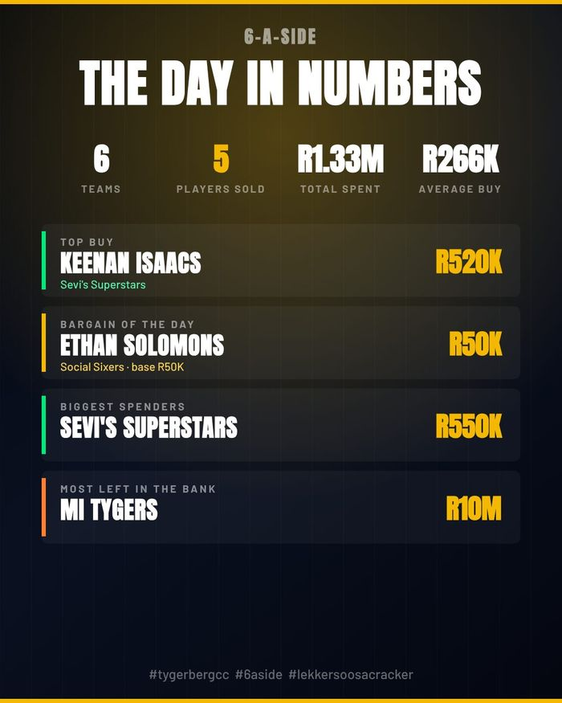
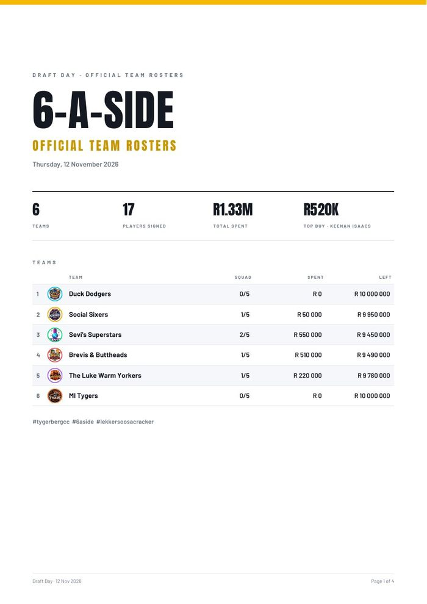

# Draft Day

**Run a club cricket player draft in the browser: a live auction, a random draw or a captains' draft.**

Draft Day shares players out to teams for club events. A setup wizard describes the event. On the night one laptop runs it, with a second window for the TV or projector. Afterwards you get a rosters PDF, shareable images and a CSV of the results.

It's plain HTML, CSS and JavaScript. There's no install and no build step, and it runs offline: open `index.html` and go.



---

## Contents

- [Features](#features)
- [Quick start](#quick-start)
- [How an event runs](#how-an-event-runs)
- [The three formats](#the-three-formats)
- [Player lists](#player-lists)
- [Outputs](#outputs)
- [Keyboard shortcuts](#keyboard-shortcuts)
- [Configuration](#configuration)
- [Project structure](#project-structure)
- [Development](#development)
- [Browser support](#browser-support)
- [Credits and licences](#credits-and-licences)

---

## Features

**Setup**
- A seven-step wizard: format, event, teams, pre-rounds, tiers, bidding and review.
- Three templates to start from: *6-a-side auction*, *Social league draw* and *Club draft*.
- Any number of teams, with captains, colours and logos (upload one, or point to a file).
- Optional pre-rounds before the main event, for retained or former players. Each round has snake or straight order, free or paid picks, and its own player list.
- Your own tiers, each with a minimum opening bid and a limit per team.
- Load or paste every player list in the wizard, so launch goes straight to the first pick.
- Presets: save the setup by name, or export and import it as JSON.
- **Rehearse** runs the whole event with made-up players and saves nothing.

**On the night**
- **Auction:** players come up by spinning wheel, random draw, list order or the auctioneer's choice. Teams bid with quick +1/+2/+5 buttons or typed amounts (`350k` and `1.2m` work).
- The app enforces the bid increment, budgets, squad size, tier limits and an optional purse reserve.
- An unsold queue gets a second auction at a discount. There's also a bid timer (pause it or add time), auto-sell, and "going once, going twice…".
- **Random allocation:** a seeded, checkable draw. It can balance by tier, and reveals players live or deals everyone at once. The same draw code always gives the same result.
- **Captains' draft:** captains take turns picking in snake or straight order.
- **Projector window:** the player, the bid, the leader, the timer and every team's purse, with no controls. It also shows the draw, the break clock and a sponsor, and has a **high-contrast** mode for bright rooms.
- **Player history:** every event remembers where each player went and for how much. When a returning player comes up, the card and the projector show their last result ("Last time · Nov 2025 (Champs 2025): R510K to MI Tygers"). History can be exported and imported.
- A break screen with a countdown and the standings, plus sound you can play on the laptop, on the projector only, or switch off.
- A calm auction screen: while a player is up, the team strip steps aside and each bid row shows the team's purse and squad. The player list folds away (**L**) for more room.
- Undo for any action (the last 60), roster fixes after the fact, and autosave with resume after a crash.

**Afterwards**
- A print-friendly rosters PDF with a recap page.
- Results images in four sizes, team cards, sold or drawn cards, and a recap card.
- A results CSV with one row per player, which opens cleanly in Excel.
- Bid History: chronological, by team, by tier, plus a summary.

**Look and accessibility**
- Light by default, with a **light/dark switch** (☾ / ☀) on every screen that also changes the projector. Both themes come from one set of colour tokens in `styles.css`.
- Everything works from the keyboard, with a clear focus ring, labelled icon buttons and dialogs that take focus.
- It respects the computer's reduce-motion setting, and pale team or tier colours are darkened automatically on light backgrounds.

---

## Quick start

1. Download or clone the repository.
2. Open `index.html` in Chrome, Edge, Firefox or Safari.
3. Work through the wizard, load your player lists on the Review step, and press **Launch**.

That's it. For the best results, serve the folder from a local web server instead of double-clicking, for example with VS Code Live Server, `npx serve` or `python -m http.server`. Opening the file directly works too, but the browser then hides logo image files from the PDF, so they appear as initials badges. Logos uploaded in the wizard always work.

Optionally, press **📺 Projector** (or **P**), drag the window onto the TV and press **⛶ Full screen**.

📖 The full user guide is in [`docs/Draft-Day-User-Guide.pdf`](docs/Draft-Day-User-Guide.pdf).

---

## How an event runs

```
Setup  →  Pre-rounds (optional)  →  Auction · Draw · Draft  →  Results
```

| Stage | What happens |
|---|---|
| **Setup** | The wizard: format, teams, rounds, tiers, rules and player lists. Launch. |
| **Pre-rounds** | Teams take turns picking from each round's list, in the pick order you set. |
| **Main event** | Players are bought, drawn or picked until the squads are full. |
| **Results** | PDF, images, recap and CSV. Save the event as a file to keep it. |



---

## The three formats

### Auction
Each team has a budget. A player comes up, teams bid or pass, and the auctioneer declares the winner, or lets auto-sell, the timer or "going once…" do it. A player nobody buys goes to an unsold queue. Once the main pool is empty, that queue is auctioned again at a discount, open only to teams that still have squad space and budget.

### Random allocation
No money and no bidding. With **balance by tier** on, players are dealt one tier at a time, so every team gets the same mix. The reveal is live (the player, then a spin or card flip for the team) or instant (everyone at once). Each draw has a code: the same code with the same teams and players always gives the same result, so anyone can check it. You can lock the draw when it's done.



### Captains' draft
No money. Captains take turns choosing from the pool in snake order (1→n, then n→1) or straight order, until every squad is full. The pick screen shows the team on the clock and why any player is blocked. Exports appear on the screen as soon as the last pick is in.



---

## Player lists

Every list uses the same columns. A header row is optional. Separate the columns with commas, or with tabs when you copy them straight from a spreadsheet.

```csv
Name,Price,Tier
Keenan Isaacs,500000,Platinum
Ethan Solomons,R200 000,Gold
"Adonis, Dylan",50k,silver
Caleb Moses
```

| Column | Rules |
|---|---|
| **Name** | Required. Duplicates are skipped. Put names that contain commas in quotes. |
| **Price** | Optional (0 if left out). Currency symbols, spaces and commas are ignored, and `250k` and `1.2m` work. Ignored in a draw or a draft. |
| **Tier** | Optional. Must match one of the event's tier names, in any case. |

Load a list as a CSV file, or use **📋 Paste a list**. You can do either in the wizard before launch or on each screen afterwards. Captains and players who already have a team are left out automatically.

---

## Outputs

| Output | File |
|---|---|
| Rosters PDF: cover, squads and recap | `<event>-rosters.pdf` |
| Results image: full, square, portrait or story | `<event>-rosters.png` |
| Team cards (1080×1350) | `<event>-team-<team>.png` |
| Sold or drawn cards (1080×1350) | `<event>-sold-<nn>-<player>.png` |
| Recap card | `<event>-recap.png` |
| Results CSV | `<event>-results.csv` |
| Save file | `<event>-save-<date-time>.json` |

You can add a sponsor (a name, a line such as "Presented by", and an optional logo) on the Review step. It appears on the projector, the cards, the results image and the PDF.

<p>
  
  
</p>

---

## Keyboard shortcuts

Press **?** in the app to see this list. Keys are ignored while you're typing in a box.

| Key | Does |
|---|---|
| `Space` | Spin or draw the next player (press again to skip). In a draw: reveal the next player |
| `1`–`9`, `0` | Quick bid (+1 increment) for team 1–10 |
| `Shift` + number | Pass for that team |
| `G` | Going once, going twice… |
| `D` / `U` / `R` | Declare winner / Unsold / Back to pool |
| `T` / `+` | Pause or resume the bid timer / add 10 seconds |
| `B` / `P` / `S` | Break screen / Projector / Sound |
| `L` | Show or hide the player list |
| `Ctrl`/`⌘` + `Z` | Undo |
| `Esc` | Close the open panel |

---

## Configuration

Most things are set in the wizard and saved as presets in the browser. `event.config.js` holds the **default** event the wizard opens with, and every setting is explained in that file:

```js
window.DRAFT_DAY_EVENT = {
  name: 'Draft Day',
  format: 'auction',            // 'auction' | 'random' | 'draft'
  currency: 'R',
  budget: 10000000,
  squadSize: 5,
  captains: true,
  draw: 'wheel',                // 'wheel' | 'random' | 'order' | 'manual'
  random: { balance: true, reveal: 'live', teamPick: 'spin' },
  draft: { order: 'snake' },
  teams: [ { name: 'Duck Dodgers', captain: 'Winslow Jooste', color: '#00c8ff', logo: 'logos/duck-dodgers.jpg' }, /* … */ ],
  rounds: [ { name: 'Former players', picks: 2, order: 'snake', cost: 'free', countsTowardSquad: false, countsTowardTiers: true } ],
  tiers: [ { name: 'Platinum', color: '#b8ccd8', minBid: 500000, limit: 2 }, /* … */ ],
  bidding: { increment: 10000, enforceIncrement: true, prefill: true, timer: 0, timerResetsOnBid: true,
             autoSell: false, reserve: true, inThousands: false },
  unsold: { enabled: true, discount: 50 },
  branding: { exportTitle: '6-A-SIDE', exportSubtitle: 'OFFICIAL TEAM ROSTERS', hashtags: '',
              sponsor: { name: '', line: 'Presented by', logo: '' } },
};
```

Edits you make in the wizard are remembered in that browser until `event.config.js` changes. After that, the file wins again.

---

## Project structure

```
draft-day/
├── index.html            The page. Open this to run Draft Day
├── event.config.js       The default event (edit freely)
├── styles.css            All styling, with design tokens at the top
├── js/                   The app: plain scripts loaded in order by index.html
│   ├── ui.js             Dialogs, icons, toasts, accessibility helpers
│   ├── setup.js          The wizard, presets, event settings
│   ├── core.js           Shared state, squad and tier rules, player lists
│   ├── audio.js          Sound
│   ├── art.js            The cartoon cricketer for each player
│   ├── wheel.js          The wheel and spinning
│   ├── rounds.js         Pre-rounds and the captains' draft
│   ├── auction.js        The pool, bidding, selling, the unsold round
│   ├── history.js        Bid History
│   ├── rosters.js        Roster pop-up and roster fixes
│   ├── exports/          images.js · pdf.js · csv.js
│   ├── state.js          Saving, autosave, undo, and commit(): the one change path
│   ├── past.js           Player history across events
│   ├── admin.js          Admin panel for a live event
│   ├── tools.js          Bid timer, break screen, going once
│   ├── input.js          Keyboard shortcuts, click actions, menus
│   ├── projector.js      The second window for the TV
│   ├── alloc.js          The random-allocation draw
│   └── boot.js           Start-up (loaded last)
├── logos/                Team logos
├── vendor/               Fonts and jsPDF, so nothing loads from the internet
├── docs/                 User guide (PDF) and screenshots
└── tests/                Automated checks, lint and formatting (developers only)
```

### How the code fits together
- **No modules and no bundler.** The scripts share one global scope so the app works straight from the folder (`file://`). `index.html` loads them in dependency order, with `boot.js` last.
- **One change path.** Every action calls `commit(label, change)`. That takes an undo snapshot, makes the change, then redraws the screen, autosaves and updates the projector. Nothing polls for changes or patches render functions.
- **One state store.** Save files, autosave, undo and resume all go through `storeRead()` and `storeWrite()`. Saves are versioned (`SAVE_VERSION`), and older saves are upgraded step by step on load.
- **Escaped templates.** Markup built in JavaScript uses the `` html`…` `` tag from `ui.js`, which escapes every value.
- **Clicks** use `data-action="fn"` with optional `data-args='[json]'`, handled by one listener in `input.js`.

---

## Development

The app needs nothing installed. The `tests/` folder is for anyone changing the code:

```bash
cd tests
npm install
npx playwright install chromium   # first time only
npm test             # browser tests (node --test + Playwright)
npm run lint         # ESLint across event.config.js and js/
npm run format       # Prettier
```

Each test starts a small local server, opens the app in headless Chromium and drives it through setup, an auction, a draw and a draft, then checks the exports. In-app dialogs accept automatically in tests (`window.DLG_AUTO = true`), and typed answers can be queued in `window.DLG_ANSWERS`.

The ESLint config reads the script order from `index.html` and treats each file's top-level names as globals for the others. That way a typo or a missing function is still caught, even without modules.

---

## Browser support

Recent Chrome, Edge, Firefox and Safari on a laptop or desktop. The projector opens as a pop-up window, so allow pop-ups for the page. Allow multiple downloads too, if you export all the cards at once. Everything is stored in the browser's local storage: autosave, presets, loaded lists and player history. Use **Save State** to keep a copy of an event as a file.

---

## Credits and licences

- Fonts: [Anton](https://fonts.google.com/specimen/Anton) and [Barlow](https://fonts.google.com/specimen/Barlow), under the SIL Open Font License (licences in `vendor/fonts/`).
- PDF generation: [jsPDF](https://github.com/parallax/jsPDF) (MIT).
- Built by Byron Daries for Tygerberg Cricket Club.
